# Self-service workshop walkthrough

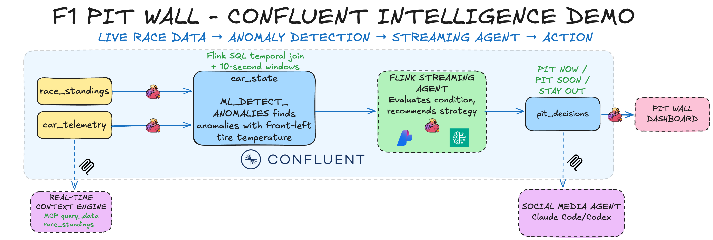

> [!NOTE]
>
> Use this path when you have your own Confluent Cloud login and will provision a Confluent-only environment (`uv run deploy --track self-service`) with the race simulator running on your machine. **If your instructor gave you a workshop login and password,** use the [hosted workshop walkthrough](./HOSTED-WORKSHOP.md).

## 0. Clone, install, and provision

You need a Confluent Cloud account ([Sign up for Confluent Cloud](https://www.confluent.io/confluent-cloud/tryfree/?utm_campaign=tm.plg_cd.techxchange2026&utm_source=lab&utm_medium=github))

> [!WARNING]
> ⚠️ You may be asked to create a cluster during sign-up. **Skip it** — Terraform creates your cluster later.

1. Add a payment method (credit card or promo code) in Confluent Cloud.

    A payment method or promo code is required for Terraform to create your cluster. Free credit is used first, so you typically won't be charged during the workshop.

    1. Go directly to **[Billing & payment](https://confluent.cloud/settings/billing/payment)**.
    2. Open the **Payment details and contacts** tab.
    3. Choose **one** of the two options:

        - **Option A — Credit card:** click **Add credit card / bank account**, enter your **card details**, then **Save**.
        - **Option B — Promo code (provided by the workshop host):** scroll down to **Promos**, click **+ Promo code**, enter the code you were given, then **Apply**. No credit card is needed.

        

2. Install the prerequisites:

> [!TIP]
> **TechXChange attendee, or provided a workstation by the workshop host?** Skip step 2 (install the prerequisites) — it's already set up for you. Start with step 1 to add your promo code.

<details>
<summary><strong>Prerequisites for your own machine</strong> — skip this step if you are a TechXChange attendee or were given a workstation (click to expand)</summary>

<details>
<summary>for Mac</summary>

```bash
brew install git uv
brew tap hashicorp/tap
brew install hashicorp/tap/terraform
brew install --cask confluent-cli
```

</details>

<details>
<summary>for Windows</summary>

```powershell
winget install --id Git.Git -e
winget install --id astral-sh.uv -e
winget install --id Hashicorp.Terraform -e
```

The Confluent CLI has no reliable winget package. Download the latest `confluent_*_windows_amd64.zip` from the [Confluent CLI releases](https://github.com/confluentinc/cli/releases/latest), unzip it, and add the folder containing `confluent.exe` to your `PATH`. Then close and reopen the terminal so every tool is on your `PATH`.

</details>

</details>

3. Open a **Terminal** on your machine — click **Activities** (top-left), then the **Terminal** icon in the dock.

    

    Go to the workshop folder and pull the latest changes:

    ```bash
    cd workshop/4549/
    git pull
    ```

    <details>
    <summary><strong>Using your own machine?</strong> Clone the repo instead</summary>

    ```bash
    git clone https://github.com/confluentinc/demo-confluent-intelligence-f1.git
    cd demo-confluent-intelligence-f1
    ```

    </details>

4. Provision the environment:

    ```bash
    uv run deploy --track self-service
    ```

    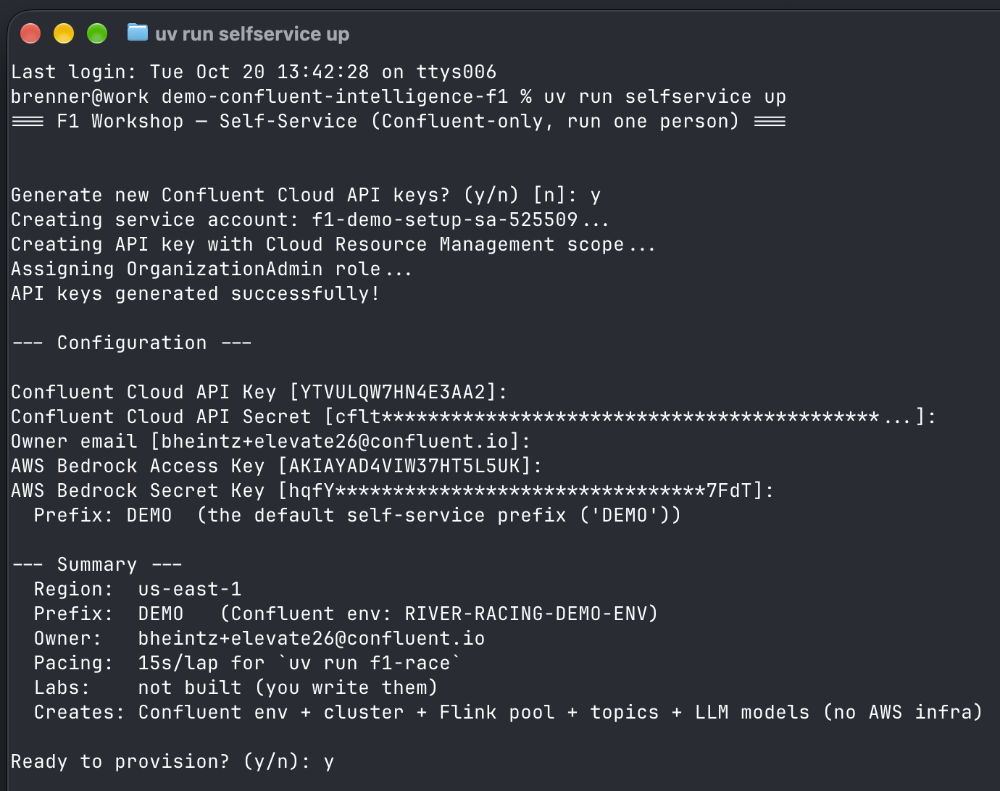

    The command prompts for the following:

    | Prompt | Where to get it |
    |---|---|
    | Confluent Cloud Email / Password | The **email and password you used to sign up**. They are verified with a real login, then saved to `credentials.env` so later commands log in automatically. (**Single sign-on?** Press **Enter** at the email prompt. If you are not already logged in, it offers to run the SSO login for you.) |
    | Generate new Confluent Cloud API keys? | Answer `y` — `uv` creates the API key and secret for you |
    | Confluent Cloud API Key / Secret | Press **Enter** to confirm the key and secret `uv` just created |
    | Owner email | Press **Enter** — it defaults to the email you just logged in with |

## 1. Enhance the data with built-in ML functions and start the race

The provisioning step sets up source tables for car telemetry, live race standings, and historical race results. Next, we will create a `car_state` table that joins telemetry with race standings over 20-second tumbling windows and uses Confluent's built-in `ML_DETECT_ANOMALIES` function to flag abnormal front-left tire temperatures.

1. Open the [SQL workspace](https://confluent.cloud/workspaces/) in the Confluent Cloud Console. Select `RIVER-RACING-DEMO-ENV` as the **catalog** and `RIVER-RACING-DEMO-CLUSTER` as the **database**.

    <details>
    <summary>Optional: Explore the pre-deployed source tables and models</summary>

    ```sql
    SHOW TABLES;
    ```

    | Table | Source | Format |
    |-------|--------|--------|
    | `car_telemetry` | Race simulator — car #88 sensors, every 2s | Avro |
    | `race_standings` | Race simulator — all 22 cars, keyed by `car_number` (upsert) | Avro |
    | `driver_race_history` | 198 historical race rows seeded during setup | JSON |

    ```sql
    SELECT COUNT(*) FROM driver_race_history;
    SHOW MODELS;        -- llm_textgen_model
    SHOW CONNECTIONS;   -- the Bedrock connection behind it (none with CSP Hosted inference)
    ```

    </details>

2. Paste this statement into one SQL cell and run it. Wait for it to show **Running** (leave it running for the rest of the walkthrough).

    ```sql
    CREATE TABLE `car_state` WITH ('changelog.mode' = 'append', 'kafka.consumer.isolation-level' = 'read-uncommitted') AS
    WITH enriched AS (
      SELECT
        t.car_number, t.event_time, t.lap,
        t.tire_temp_fl_c, t.tire_temp_fr_c, t.tire_temp_rl_c, t.tire_temp_rr_c,
        t.tire_pressure_fl_psi, t.tire_pressure_fr_psi, t.tire_pressure_rl_psi, t.tire_pressure_rr_psi,
        t.engine_temp_c, t.brake_temp_fl_c, t.brake_temp_fr_c, t.battery_charge_pct, t.fuel_remaining_kg,
        r.`position`, r.gap_to_ahead_sec, r.gap_to_leader_sec, r.pit_stops, r.tire_compound, r.tire_age_laps
      FROM `car_telemetry` t
      JOIN `race_standings` /*+ OPTIONS('scan.startup.mode'='earliest-offset') */ FOR SYSTEM_TIME AS OF t.event_time AS r ON t.car_number = r.car_number
    ),
    windowed AS (
      SELECT
        window_start, window_end, window_time, car_number, MAX(lap) AS lap,
        AVG(tire_temp_fl_c) AS tire_temp_fl_c, AVG(tire_temp_fr_c) AS tire_temp_fr_c,
        AVG(tire_temp_rl_c) AS tire_temp_rl_c, AVG(tire_temp_rr_c) AS tire_temp_rr_c,
        AVG(tire_pressure_fl_psi) AS tire_pressure_fl_psi, AVG(tire_pressure_fr_psi) AS tire_pressure_fr_psi,
        AVG(tire_pressure_rl_psi) AS tire_pressure_rl_psi, AVG(tire_pressure_rr_psi) AS tire_pressure_rr_psi,
        AVG(engine_temp_c) AS engine_temp_c, AVG(brake_temp_fl_c) AS brake_temp_fl_c, AVG(brake_temp_fr_c) AS brake_temp_fr_c,
        AVG(battery_charge_pct) AS battery_charge_pct, AVG(fuel_remaining_kg) AS fuel_remaining_kg,
        MAX(`position`) AS `position`, MAX(gap_to_ahead_sec) AS gap_to_ahead_sec, MAX(gap_to_leader_sec) AS gap_to_leader_sec,
        MAX(pit_stops) AS pit_stops, MAX(tire_compound) AS tire_compound, MAX(tire_age_laps) AS tire_age_laps
      FROM TABLE(TUMBLE(TABLE enriched, DESCRIPTOR(event_time), INTERVAL '20' SECOND))
      GROUP BY window_start, window_end, window_time, car_number
    ),
    anomaly AS (
      SELECT *,
        ML_DETECT_ANOMALIES(tire_temp_fl_c, window_time,
          JSON_OBJECT('minTrainingSize' VALUE 12, 'maxTrainingSize' VALUE 50, 'confidencePercentage' VALUE 99.99, 'enableStl' VALUE FALSE))
          OVER (PARTITION BY car_number ORDER BY window_time RANGE BETWEEN UNBOUNDED PRECEDING AND CURRENT ROW) AS anomaly_tire_temp_fl_result
      FROM windowed
    )
    SELECT
      car_number, lap,
      tire_temp_fl_c, tire_temp_fr_c, tire_temp_rl_c, tire_temp_rr_c,
      tire_pressure_fl_psi, tire_pressure_fr_psi, tire_pressure_rl_psi, tire_pressure_rr_psi,
      engine_temp_c, brake_temp_fl_c, brake_temp_fr_c, battery_charge_pct, fuel_remaining_kg,
      CASE
        WHEN anomaly_tire_temp_fl_result.is_anomaly AND anomaly_tire_temp_fl_result.actual_value > anomaly_tire_temp_fl_result.upper_bound THEN true
        ELSE false
      END AS anomaly_tire_temp_fl,
      `position`, gap_to_ahead_sec, gap_to_leader_sec, pit_stops, tire_compound, tire_age_laps
    FROM anomaly
    WHERE lap > 0;
    ```

3. Start the race in your local terminal:

    ```bash
    uv run f1-race
    ```

    Leave it running. `car_state` emits one row per 20-second window. After 12 windows (~4 minutes) it has enough history to detect temperature anomalies on the front-left tire; at lap 24 the tire spikes to ~145°C and `anomaly_tire_temp_fl` becomes `true`.

4. Open the Pit Wall dashboard. If you accepted the deploy prompt to start it, it's already running at http://localhost:8000. Otherwise, in a **second terminal**, run:

    ```bash
    uv run f1-pitwall
    ```

    The dashboard at http://localhost:8000 shows the Silverstone track map, the live leaderboard, and car #88's tyre/fuel gauges. The **Anomaly Detection** panel unlocks as `car_state` emits rows, and the **AI Pit Strategist** panel unlocks once you create `pit_decisions` in Section 3.

    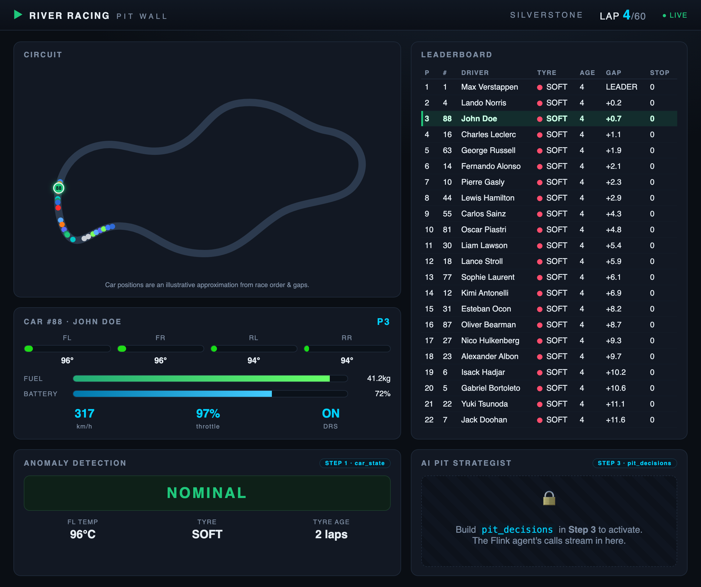

5. Verify the stream in a new SQL cell:

    ```sql
    SELECT car_number, lap, `position`, tire_compound, tire_age_laps, anomaly_tire_temp_fl, tire_temp_fl_c
    FROM `car_state`;
    ```

## 2. Create the agent to provide pit decision guidance

With `car_state` streaming, we can create `pit_strategy_agent` to evaluate car condition and race context on every lap and recommend `STAY OUT`, `PIT SOON`, or `PIT NOW`.

1. Paste and run the `CREATE AGENT` statement in your SQL Workspace:

    ```sql
    CREATE AGENT `pit_strategy_agent`
    USING MODEL `llm_textgen_model`
    USING PROMPT 'OUTPUT FORMAT — respond with exactly these 7 labeled lines in this order. Plain text only, no markdown or bold.

    Suggestion: [PIT NOW | PIT SOON | STAY OUT]
    Condition Summary: [one sentence describing current car condition]
    Race Context: [one sentence on race situation]
    Recommended Compound: [SOFT | MEDIUM | HARD | N/A if STAY OUT]
    Recommended Stint Laps: [integer expected laps on new tires | N/A if STAY OUT]
    Recommended Reason: [one sentence explaining compound choice | N/A if STAY OUT]
    Reasoning: [2-4 sentences full explanation of your decision]

    Correct STAY OUT example:
    Suggestion: STAY OUT
    Condition Summary: Front-left tire temperature is nominal at 107C with 18 laps of age on SOFT compound.
    Race Context: Currently P3. Leader is 8.2s ahead.
    Recommended Compound: N/A
    Recommended Stint Laps: N/A
    Recommended Reason: N/A
    Reasoning: No anomaly has been detected, so tire temps and pressures are within normal operating windows for this stage of the stint. Track position P3 is strong and pitting now would surrender 4-6 seconds.

    Correct PIT NOW example:
    Suggestion: PIT NOW
    Condition Summary: Front-left tire temperature anomaly at 145C, 20C above expected upper bound — failure risk imminent.
    Race Context: Currently P8 with 36 laps remaining.
    Recommended Compound: MEDIUM
    Recommended Stint Laps: 36
    Recommended Reason: Mediums will carry John to the flag across the remaining 36 laps and give him the pace to recover positions lost during the stop.
    Reasoning: The FL anomaly flag indicates the SOFT has gone past its operating limit with blowout risk. Pitting now onto mediums avoids tire failure. Based on historical data, John averages +2.75 positions on SOFT-MEDIUM — this is his strongest strategy.

    ---

    You are the AI pit wall strategist for River Racing at the 2026 British Grand Prix (Silverstone, 60 laps). Driver: John Doe, Car #88.

    DECISION FRAMEWORK — weigh these in priority order:
    1. Anomaly signal: anomaly_tire_temp_fl comes from a trained statistical anomaly detector (ML_DETECT_ANOMALIES) that evaluates tire_temp_fl_c against expected bounds. PIT NOW is reserved for this signal being true — treat it as validated evidence of a real tire problem requiring an immediate stop. When it is false, a raw temperature reading that merely looks high is still within expected bounds for the stint. Nothing else in this input — not tire age, not race context, not competitor behavior — should produce PIT NOW; those inform PIT SOON or STAY OUT instead.
    2. Pit history: a car that has already pitted this race should usually stay out and run its current tires to the end, absent a new anomaly.
    3. Tire age and compound: a SOFT tire past ~20 laps enters its strategic pit window. Call PIT SOON (never PIT NOW) throughout this window when no anomaly is flagged.
    4. Otherwise: default to STAY OUT.

    STRICT OUTPUT VALUES — the Suggestion line must be the exact literal string PIT NOW, PIT SOON, or STAY OUT with no extra text. For STAY OUT, write N/A for Recommended Compound, Recommended Stint Laps, and Recommended Reason.

    TIRE STRATEGY at Silverstone (60-lap race):
    - SOFT: Optimal laps 1-19; degrades in laps 20-22 (PIT SOON window), no failure risk unless the anomaly sensor fires.
    - MEDIUM: Best for a 30-40 lap second stint after SOFT (clean 1-stop).
    - HARD: Durable but slow; only for 40+ lap stints.
    - John Doe historical best: SOFT -> MEDIUM 1-stop averages +2.75 positions over 4 prior races.'
    WITH ('max_iterations' = '10');
    ```

2. Confirm that the agent is registered:

    ```sql
    SHOW AGENTS;
    ```

## 3. Create the pit decisions table

Next we create the `pit_decisions` table, which invokes `pit_strategy_agent` on every row of `car_state` using [`AI_RUN_AGENT`](https://docs.confluent.io/cloud/current/flink/reference/functions/model-inference-functions.html#ai-run-agent) and parses the structured fields. Because it reads `car_state` from `earliest-offset`, it also processes laps that have already arrived.

1. Create the `pit_decisions` table in your SQL Workspace (leave this query running):

    ```sql
    CREATE TABLE `pit_decisions` WITH ('changelog.mode' = 'append', 'kafka.consumer.isolation-level' = 'read-uncommitted') AS
    SELECT
      cs.car_number, cs.lap, cs.`position`,
      cs.tire_compound AS tire_compound_current, cs.tire_age_laps, cs.anomaly_tire_temp_fl,
      TRIM(REGEXP_EXTRACT(CAST(response AS STRING), '\*{0,2}Suggestion:\*{0,2}\s*([^\n]+)', 1)) AS suggestion,
      TRIM(REGEXP_EXTRACT(CAST(response AS STRING), '\*{0,2}Condition Summary:\*{0,2}\s*([^\n]+)', 1)) AS condition_summary,
      TRIM(REGEXP_EXTRACT(CAST(response AS STRING), '\*{0,2}Race Context:\*{0,2}\s*([^\n]+)', 1)) AS race_context,
      NULLIF(TRIM(REGEXP_EXTRACT(CAST(response AS STRING), '\*{0,2}Recommended Compound:\*{0,2}\s*([^\n]+)', 1)), 'N/A') AS recommended_tire_compound,
      CAST(NULLIF(TRIM(REGEXP_EXTRACT(CAST(response AS STRING), '\*{0,2}Recommended Stint Laps:\*{0,2}\s*([^\n]+)', 1)), 'N/A') AS INT) AS recommended_stint_laps,
      NULLIF(TRIM(REGEXP_EXTRACT(CAST(response AS STRING), '\*{0,2}Recommended Reason:\*{0,2}\s*([^\n]+)', 1)), 'N/A') AS recommended_reason,
      TRIM(REGEXP_EXTRACT(CAST(response AS STRING), '\*{0,2}Reasoning:\*{0,2}\s*([\s\S]+?)$', 1)) AS reasoning,
      CAST(response AS STRING) AS raw_response
    FROM `car_state` /*+ OPTIONS('scan.startup.mode'='earliest-offset') */ cs,
    LATERAL TABLE(AI_RUN_AGENT(
      `pit_strategy_agent`,
      CONCAT(
        'CAR STATE — Lap ', CAST(cs.lap AS STRING), ' of 60 | Silverstone British Grand Prix\n',
        'Driver: John Doe (#', CAST(cs.car_number AS STRING), ') | Current Position: P', CAST(cs.`position` AS STRING), '\n',
        '\nTIRE DATA:\n',
        '  Compound: ', cs.tire_compound, ' | Age: ', CAST(cs.tire_age_laps AS STRING), ' laps\n',
        '  FL Temp: ', CAST(ROUND(cs.tire_temp_fl_c, 1) AS STRING), 'C  FR: ', CAST(ROUND(cs.tire_temp_fr_c, 1) AS STRING), 'C  RL: ', CAST(ROUND(cs.tire_temp_rl_c, 1) AS STRING), 'C  RR: ', CAST(ROUND(cs.tire_temp_rr_c, 1) AS STRING), 'C\n',
        '  FL Pressure: ', CAST(ROUND(cs.tire_pressure_fl_psi, 1) AS STRING), 'psi  FR: ', CAST(ROUND(cs.tire_pressure_fr_psi, 1) AS STRING), 'psi  RL: ', CAST(ROUND(cs.tire_pressure_rl_psi, 1) AS STRING), 'psi  RR: ', CAST(ROUND(cs.tire_pressure_rr_psi, 1) AS STRING), 'psi\n',
        '  FL Tire Anomaly Detected: ', CAST(cs.anomaly_tire_temp_fl AS STRING), '\n',
        '\nCAR SYSTEMS:\n',
        '  Engine Temp: ', CAST(ROUND(cs.engine_temp_c, 1) AS STRING), 'C  Brake FL: ', CAST(ROUND(cs.brake_temp_fl_c, 1) AS STRING), 'C  Brake FR: ', CAST(ROUND(cs.brake_temp_fr_c, 1) AS STRING), 'C\n',
        '  Battery: ', CAST(ROUND(cs.battery_charge_pct, 1) AS STRING), '%  Fuel Remaining: ', CAST(ROUND(cs.fuel_remaining_kg, 1) AS STRING), 'kg\n',
        '\nRACE CONTEXT:\n',
        '  Gap to Leader: ', CAST(ROUND(cs.gap_to_leader_sec, 2) AS STRING), 's  Gap to Car Ahead: ', CAST(ROUND(cs.gap_to_ahead_sec, 2) AS STRING), 's\n',
        '  Pit Stops Taken: ', CAST(cs.pit_stops AS STRING), '\n',
        '  Laps Remaining: ', CAST(60 - cs.lap AS STRING)
      ),
      MAP['debug', 'true']
    ));
    ```

## 4. Review the results

1. Query `pit_decisions` in your SQL Workspace to see the streaming recommendations:

    ```sql
    SELECT lap, `position`, suggestion, condition_summary, reasoning
    FROM `pit_decisions`;
    ```

    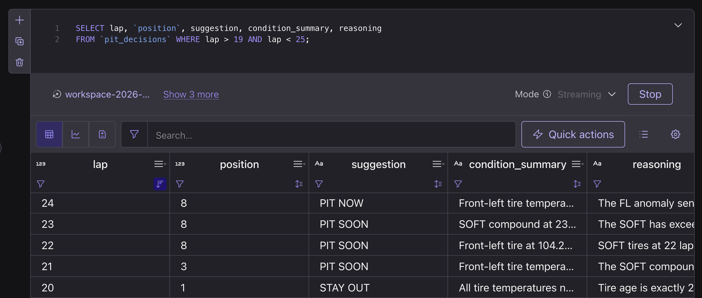

2. Filter for the tire temperature anomaly to inspect the lap 24 pit call:

    ```sql
    SELECT lap, `position`, tire_compound_current, tire_age_laps, anomaly_tire_temp_fl,
           suggestion, recommended_tire_compound, recommended_stint_laps, reasoning
    FROM `pit_decisions`
    WHERE anomaly_tire_temp_fl = true;
    ```

    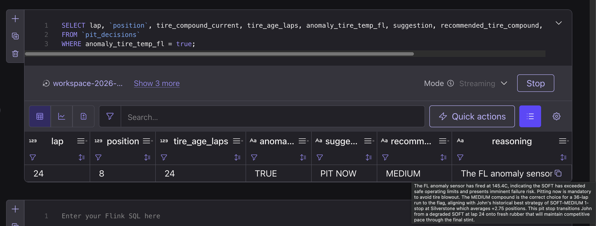

> [!NOTE]
>
> | Lap | Position | Suggestion | What's happening |
> |---|---|---|---|
> | 1–18 | P3 → P1 | `STAY OUT` | Competitive, nominal tire temps |
> | ~19–23 | P1 → P8 | `PIT SOON` | Aging SOFTs enter the strategic pit window |
> | **24** | **P8** | **`PIT NOW`** | **Front-left anomaly (~145°C) triggers an immediate stop** |
> | 25–60 | P14 → P1–P2 | `STAY OUT` | Recovery stint to the flag on fresh MEDIUMs |
>
> `PIT SOON` can start anywhere from about lap 19 to 23. The exact laps vary by run.
>
> As `car_state` and `pit_decisions` produce rows, the Pit Wall dashboard unlocks its **Anomaly Detection** and **AI Pit Strategist** panels:

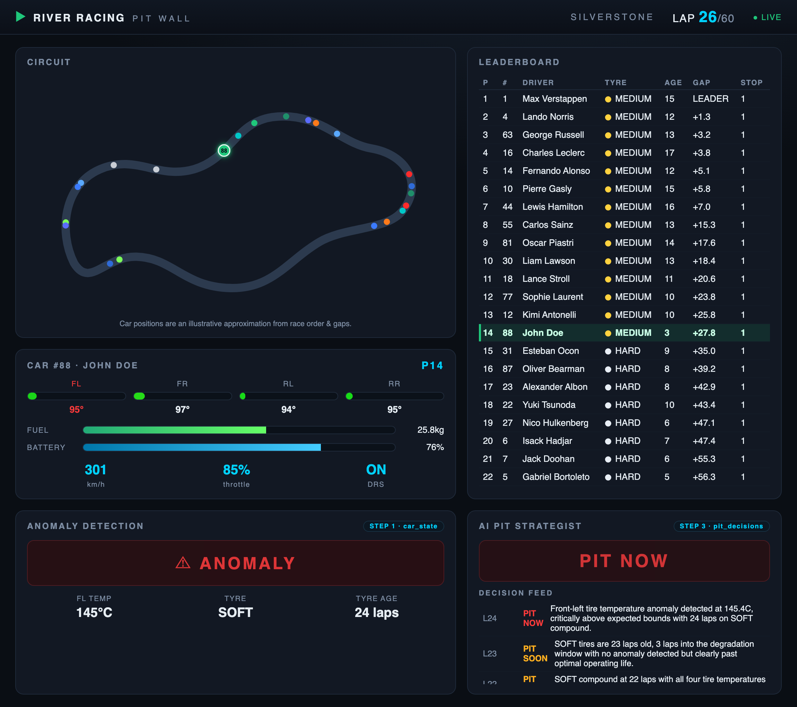

## (Optional) Expose `car_telemetry` to AI agents with Real-Time Context Engine

Real-Time Context Engine (RTCE) exposes a Kafka topic as an MCP tool, so any MCP-compatible AI agent can query the live stream. `uv run deploy --track self-service` minted a Global RTCE API key onto your credential card, and you enable RTCE **per topic in the Console** for `car_telemetry` (and optionally `car_state` or `pit_decisions`).

1. Under your environment's cluster, open **[Topics](https://confluent.cloud/go/topics) → `car_telemetry`**, open the **Real-Time Context Engine** panel, and click **Enable** (or **Turn on**). Once enabled, the **Topics** list shows Real-Time Context Engine **On**:

    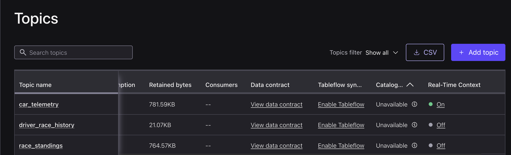

    The panel displays the enablement details — environment, cluster, cloud, and region — that an MCP client uses to reach it:

    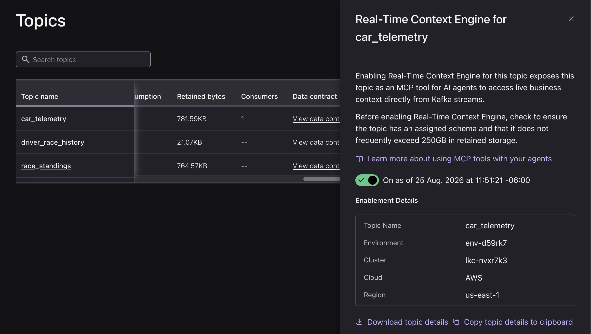

2. Point your coding agent at it in one command:

    ```bash
    uv run setup-rtce
    ```

    This registers RTCE as an MCP server with Claude Code (or prints a config snippet for Codex CLI), using the `F1_RTCE_MCP_ENDPOINT`, `F1_RTCE_API_KEY`, and `F1_RTCE_API_SECRET` fields on your credential card. Restart your coding agent, then ask questions in plain English:

    ```text
    What topics do I have access to in the Real-Time Context Engine?
    ```

    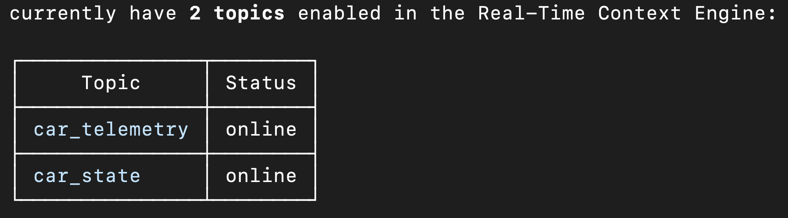

    ```text
    How has the engine temperature been trending over the last few laps?
    ```

    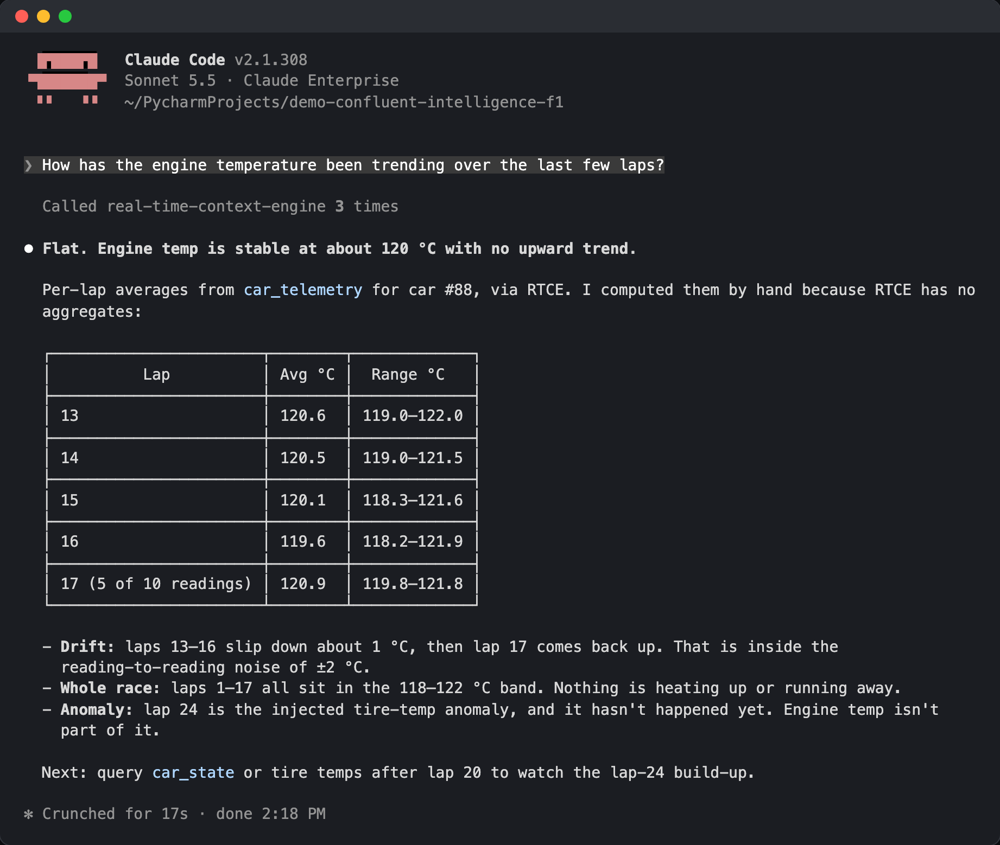

    ```text
    What's the front-left tire temperature on car 88 right now?
    ```

    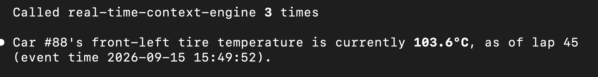

    ```text
    At what lap in the race does the engine temperature peak?
    ```

    ```text
    What is the front right tire temperature at lap 30?
    ```

## 🧩 (Optional) Challenge #1 — Social Media Agent (Claude + Real-Time Context Engine)

Now, it's time to switch gears and take on the role of the social media team for River Racing. You've been given access to the live race data via RTCE and need to use AI to generate an engaging social media post. Based on what you've learned in the workshop, do the following:

1. Enable RTCE on the `car_state` and `pit_decisions` topics in the Confluent Cloud Console (the same way you enabled `car_telemetry` above).
2. Create a persona prompt for your agent to help it develop an engaging social media post. 
3. Have your agent draft a post using real time data from your MCP connection. 

Feel free to use one of the following prompts to draft your next post: 
- "We just made a big move — write a post celebrating it."
- "The pit wall just made a call. Draft a post about our strategy."
- "Write a 3-tweet recap thread of John's race so far."

**Success looks like:** Claude calls `queryData` against `car_state` and `pit_decisions` (you'll see the tool calls in the transcript) and returns a drafted post citing the real lap number, position, and strategy call from your live feed — not invented numbers. If it says the feed is quiet, the race may not be running yet, or RTCE isn't enabled on one of the two topics.

## 🧩 (Optional) Challenge #2 — Analyze race data with Lightning Queries

> [!IMPORTANT]
> Lightning Queries must be enabled for your Confluent organization. If `uv run setup-rtce --lightning` reports `api_not_enabled`, skip this challenge and ask your instructor.

Now, we'll see how this real-time context becomes queryable with Lightning Tables and Lightning Queries. Lightning Queries read an RTCE-enabled topic over low-latency REST, so enable RTCE on `car_telemetry` in the Console first if you haven't already.

From the repo directory, print a ready-to-run query:

```bash
uv run setup-rtce --lightning
```

Copy the printed `curl` command into your terminal and run it. It returns the last 10 telemetry rows by lap; edit the SQL in `query` to filter for car 88 or select other columns. 

**Your challenge:** enable RTCE on `pit_decisions` in the Console. Then edit the `curl` command's `query` to find out what tire compound the agent recommended on lap 24, and why.

<details>
<summary>Hint</summary>

```sql
SELECT lap, <column>, <column> FROM pit_decisions WHERE lap = 24 LIMIT 1
```

Fill in the first `<column>` with the recommended tire compound, and the second with the agent's reasoning for that call.

</details>

## Run the workshop again or tear it down

Stop `f1-race` with Ctrl-C when you finish. Use `reset` when you want to erase the race history and repeat the workshop from a clean slate:

```bash
uv run reset
```

After reset, recreate `car_state`, wait for it to show **Running**, then start `uv run f1-race` again (or run `uv run reset --with-labs` to rebuild `car_state`, `pit_strategy_agent`, and `pit_decisions` automatically before starting `uv run f1-race`).

When you're ready to tear down all resources associated with the lab, run:

```bash
uv run destroy
```

After the environment is destroyed, it asks whether to delete `credentials.env` too (default **yes**). Answer `n` if you plan to re-deploy with the same credentials.

If you minted temporary Bedrock IAM keys with `uv run api-keys create`, revoke them as well:

```bash
uv run api-keys destroy
```

<details>
<summary>Troubleshooting</summary>

- **`car_state` is empty at first.** `car_state` emits one row per 20-second window, and `f1-race` aligns lap 1 to the next 20-second wall-clock boundary before starting. Make sure `car_state` is **Running** before starting `uv run f1-race`.
- **No anomaly around lap 24.** `ML_DETECT_ANOMALIES` needs 12 windows of context (`minTrainingSize = 12`) before lap 24. If `car_state` was started mid-race after lap 12, reset and start `car_state` before `uv run f1-race`.
- **Agent fields are null but `raw_response` has text.** Inspect `SELECT lap, suggestion, raw_response FROM pit_decisions LIMIT 5;`. If `raw_response` is empty across the board, verify your Bedrock credentials have `bedrock:InvokeModel` permission in `us-east-1` (Bedrock), or that your org can use CSP Hosted inference (`SHOW MODELS` lists `system.anthropic.*` models).
- **`No credential card found` / `Multiple credential cards found`.** Pass `--creds runs/selfservice/credentials/DEMO.env` or re-run `uv run deploy --track self-service` to refresh `F1_CARD` in `credentials.env`.

</details>

---

**← Back to Overview**: [Main README](../../README.md)
